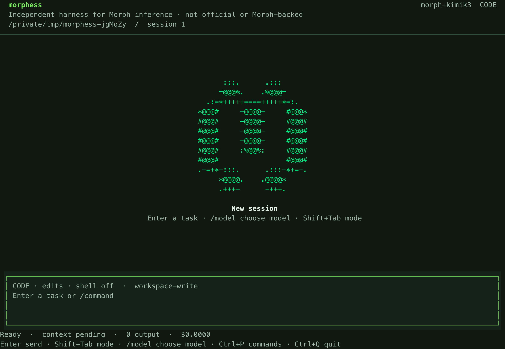

<div align="center">

<h1>Morphess</h1>

<p><strong>A durable coding agent for your terminal.</strong><br>
Code mode, MCP, and persistent sessions for Morph inference and OpenAI-compatible models.</p>

<p>
  <a href="https://github.com/Belweave/morphess/blob/main/package.json"></a>
  <a href="https://github.com/Belweave/morphess/actions/workflows/check.yml"></a>
  <a href="https://nodejs.org/"></a>
  <a href="LICENSE"></a>
</p>

<p>
  <a href="#install-from-this-checkout">Install</a> &nbsp;·&nbsp;
  <a href="#configure">Configure</a> &nbsp;·&nbsp;
  <a href="#commands">Commands</a> &nbsp;·&nbsp;
  <a href="#documentation">Documentation</a>
</p>

<p></p>

<p><sub>Independent and unofficial. Morphess is not developed, endorsed, sponsored, or backed by Morph.</sub></p>

</div>

Built on [Pi Durable](https://github.com/earendil-works/pi), Morphess keeps conversations, tool execution, SQLite recovery, and task ownership in one runtime. Use the focused terminal workspace, run tasks from the CLI, or connect through the HTTP API. Model and context limits are configurable, including text and image input with a 1M-token context window when supported by your provider.

The default view keeps the conversation and composer in focus. **Ctrl+P** opens commands, **Shift+Tab** switches Code and Plan, **/model** loads the provider's model catalog, and **Ctrl+B** toggles the session sidebar.

## Install from this checkout

The terminal requires Node 26.4+ on macOS or Linux. Headless commands and library use require Node 22.19+.

```sh
git clone https://github.com/Belweave/morphess.git
cd morphess
npm ci --ignore-scripts
npm run check
npm pack
npm install --global ./belweave-morphess-0.2.5.tgz --omit=dev --ignore-scripts
export PATH="$(npm prefix --global)/bin:$PATH"
morphess --version
morphess --help
```

Keep the npm global prefix's `bin` directory on your shell's PATH. Rebuild, pack, and install again after updating the checkout.

## Configure

From the project you want to work on:

```sh
morphess init
```

Morph defaults are ready to configure with `morphess auth login`. Use `morphess configure` to change endpoint/model settings. The TUI’s `/model` picker fetches the provider catalog; **Shift+Tab** cycles Code and Plan modes. Model configuration example:

```json
{
  "model": {
    "baseUrl": "https://api.morphllm.com/v1",
    "id": "morph-kimik3",
    "api": "chat-completions",
    "apiKeyEnv": "MORPH_API_KEY",
    "contextWindow": 1000000,
    "maxOutputTokens": 32768,
    "input": ["text", "image"]
  }
}
```

Set the environment variable named by `model.apiKeyEnv` to your endpoint credential. For an explicitly unauthenticated local endpoint, set `model.allowUnauthenticated` to `true`. Set context and output limits to values supported by your model.

```sh
morphess auth login
morphess doctor
morphess
```

`doctor` checks configuration and credential presence; it does not send an inference request. The default configuration enables code mode and permits workspace file edits while denying arbitrary shell execution.

For full host shell access, including `tools.bash(...)` from code mode, launch `morphess --full-access` (`--trusted` is equivalent). In an open TUI, `/permissions` reviews the grant and can restart the host with access enabled. `/errors` shows retained session failures. Plan mode remains read-only; use `/code` or Shift+Tab for the coding workflow.

## Commands

```sh
morphess tui --session root
morphess menu
morphess models --json
morphess tools --all
morphess tools read --json --session root
morphess run "Inspect this repository and explain the parser"
morphess run "Implement the attached layout" --image ./layout.png --json
morphess --trusted run "Fix the parser and run its tests"
morphess sessions
morphess usage --json
morphess export root
morphess fork root 123
morphess resume
morphess serve --port 8787
```

Use `morphess --help` for command groups and `morphess <command> --help` for arguments and examples. `-C <directory>` selects a workspace; `-c <file>` selects a configuration file. `run --events` emits durable JSONL events; `run --request-id <key>` deduplicates admission within a conversation.

`--trusted` permits commands to execute with the host process's authority. File-tool checks and code mode do not isolate host shell execution. Use a separate container or VM when host isolation is required.

## Tools and interfaces

| Capability | Tools or interface |
| --- | --- |
| Workspace files | `read`, `read_bytes`, `write`, `edit`, `list_files`, `search` |
| Commands and Git | `bash`, `git_status`, `git_diff` |
| Project guidance | `read_instructions`, `load_skill` |
| Working state | `update_plan`, `remember` |
| Human input | `ask_user`; terminal and authenticated HTTP answers |
| Delegation | `delegate` with researcher, reviewer, or coder role |
| Programmatic calls | `codemode` over enabled tools; `tool_search` for deferred declarations |
| Extensions | Explicit trusted ESM plugins and configured MCP servers |
| Integration | Native session API, SSE events, OpenAI-compatible chat gateway |

Run `morphess tools --all --json` for the installed catalog and `morphess tools <name> --session <id>` for a tool's schema and availability. Shell and filesystem policy also apply to code mode and delegated calls. Code mode does not expose direct model APIs.

One host process owns each `stateDir`. Closing the terminal preserves accepted work; aborting cancels the selected task subtree. Session storage contains prompts, source, attachments, and tool results and must be treated as sensitive.

## Documentation

- [Provider configuration and credentials](docs/providers.md)
- [Terminal controls](docs/tui.md)
- [Configuration, permissions, recovery, and limits](docs/operations.md)
- [Plugin, code mode, and delegation contracts](docs/extensions.md)
- [Cache configuration and usage](docs/cache.md)
- [MCP configuration and capabilities](docs/mcp.md)
- [HTTP API](docs/api.md)
- [Runtime architecture](docs/architecture.md)
- [Verification commands](docs/validation.md)

## License

[MIT](LICENSE). Dependency notices and Morph trademark attribution are in [THIRD_PARTY_NOTICES.md](THIRD_PARTY_NOTICES.md).
