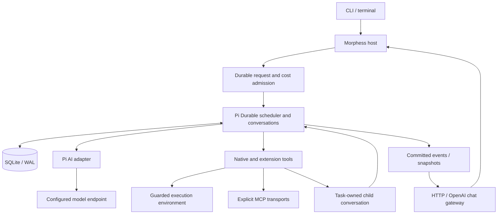

# Architecture and upstream research

Morphess extends Pi Durable rather than reimplementing its loop. Dependencies are pinned to `1.4.0`; the lockfile pins the complete resolved graph.

## Primary sources inspected

- [Pi Durable announcement](https://earendil.com/posts/pi-durable/).
- [Pi at d5b3de22d0e24a3e9c38a9410d3329b099717283](https://github.com/earendil-works/pi/tree/d5b3de22d0e24a3e9c38a9410d3329b099717283): durable README, generation/task/environment APIs, tool search, code mode, examples 21–30, and installed 1.4.0 source/types.
- [DeepSeek Harness at 22ddee3792402c3e70ec5f86a63c3e3e895a2f60](https://github.com/deepseek-ai/deepseek-harness/tree/22ddee3792402c3e70ec5f86a63c3e3e895a2f60): architecture, guarded tool pipeline, filesystem search capabilities, plugin composition, and subagent design.
- [OpenTUI at 85339b24a1056b09bc729f488c99d6cfbe3a6125](https://github.com/anomalyco/opentui/tree/85339b24a1056b09bc729f488c99d6cfbe3a6125): native Core renderer, Node FFI support, Markdown, multiline editor, scroll boxes, command selection and native test utilities. Runtime dependency pinned to 0.7.0.
- [Official OpenAI function calling documentation](https://developers.openai.com/api/docs/guides/function-calling): tool-call/result association and preservation of model response state.

The checkout commits identify material studied, not vendored releases or stability claims.

## Execution

`MorphessRuntime.open()` validates config, claims the writer lock, builds the environment/registry, and opens SQLite. A session document binds storage to one canonical workspace. The host reapplies its model selection and resumes unfinished tasks. Extension code is reconstructed at startup and resolved by persisted names.

Conversations, model responses, inputs, provider identities, tool intents, plans, notes, budget reservations, and chat idempotency records use Pi transactions and state. There is no second agent log or competing task scheduler. Host semaphores bound active work; Pi owns queued and recoverable tasks.

## Adopted decisions

| Source idea | Morphess implementation | Boundary |
| --- | --- | --- |
| Pi: commit before visibility | Native SQLite and committed event watches | WAL/NORMAL is stronger against process failure than power loss |
| Pi: explicit replay | Read tools/delegation safe; shell, mutation and MCP effects unsafe | Uncertain effects become interrupted results |
| Pi: ownership | Children belong to their invoking durable tool task | One child level; abort follows ownership |
| Pi: extensions | Native tools, sections, hooks, documents, code mode and discovery | Extension code is trusted |
| DeepSeek: capability seams | Pi registry and execution-environment seam | No Cordis or second runtime |
| DeepSeek: guarded pipeline | Environment checks apply to model and nested tool calls | Path checks are not a kernel sandbox |
| DeepSeek: scoped agents | Positive read-only allowlist; coder inherits enabled tools | Unknown tools are not assumed read-only |
| DeepSeek: progressive context | Skill metadata/loading and deferred MCP tools | Catalog refresh requires reconnect |

## Million-token context

Capacity is a model property, not an instruction to fill every request. Defaults reserve 65,536 tokens for output and retain 131,072 recent tokens; Pi performs background/blocking compaction. Estimates use reported usage where available and remain approximate for tokenizers and images.

Prompt sections change only with their underlying state. Tool output is bounded, search retrieves focused context, and skills/MCP disclose metadata before full instructions/schemas. Code mode can combine tool results before returning them to the model.

Pi's message vocabulary used here supports text/images. Audio, video and binary documents require deliberate preprocessing or a message/transport extension; unsupported types are rejected. The real endpoint and model ID must still be supplied for live validation.

## Resource admission

`maxTurns` counts admitted model request attempts per run, including retries and compactions admitted during that run. The count is committed before dispatch. A crash may consume a reservation without an answer. New inputs/child runs have new request counters; all share session cost admission.

Optional `maxSpendUsd` atomically reserves a worst-case full input window plus output at configured per-million-token rates. Confirmed usage settles the reservation before exposing the response. Missing usage or a crash retains it. This is conservative and depends on correct configured rates; it is not a provider billing guarantee or a cap on external-service charges.

Model requests are bounded to `maxConcurrentAgents + 2`. Regular tools share `max(2, maxConcurrentAgents)` execution permits; write/edit/bash make a model-issued round sequential. Delegation has a separate durable cap and holds no regular tool permit while waiting for children, avoiding parent/child semaphore deadlock.

## Verification and future work

Tests cover both wire protocols, images, fragmented tool arguments, output/deadlines, policy bypass attempts, protected state, plugin/MCP cleanup, child recovery, uncertain effects, actual SIGKILL, chat retry idempotency, SSE backpressure, and code mode. The offline eval also drives the compiled CLI through a local streaming endpoint.

Live model validation should measure coding/vision quality, exact token estimates, prompt-cache behavior, reasoning fields, image costs, argument reliability, and realistic context stress. Extension directions include isolated execution backends, LSP/ACP, editor surfaces, durable background teams, and ingestion beyond images. These are not implied to exist by offline tests.

## Terminal projection and human input

OpenTUI Core provides a single native widget tree. Pi event/document watches update a bounded projection (80 rows, 24k display text, 64k detail), coalesced every 40 ms; completed rows retain identity during unrelated changes. Full transcripts remain in Pi. Session-switch epochs discard stale deliveries and the UI tears down observers without closing its runtime. Node 26.4+ native FFI is isolated to lazily loaded terminal commands; headless use retains Node 22.19 support.

Human input is a replay-safe native tool keyed to its owning Pi tool task, backed by a Pi document and native watch. An answer is committed before visibility, same-answer delivery is idempotent, and deadlines retain their original timestamp after restart. Close preserves pending questions; abort cancels them. Suggested choices never prohibit freeform input or change execution authority. The TUI also watches ownership-verified active children, while the HTTP API routes answers by conversation/question IDs.

Selected ideas from the local pk project: role-based theme tokens, per-session draft continuity, explicit tool inspection, and stable transcript identity. Its runtime, provider stack, and complete UI hierarchy are not embedded.
