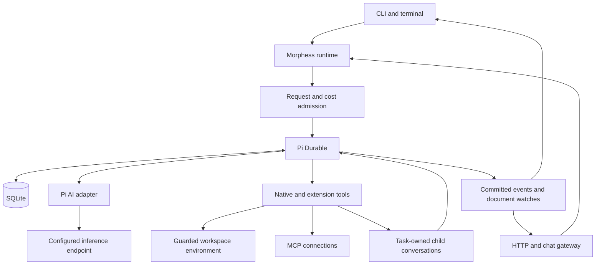

# Runtime architecture

Morphess uses Pi Durable 1.4.0 for conversations, submissions, task checkpoints, ownership, tool intents, compaction, and recovery. OpenTUI projects native events; it does not schedule agent work.

## Runtime lifecycle

`MorphessRuntime.open()` validates configuration, claims a writer lock, creates the guarded environment and extension registry, and opens SQLite. A native session document binds the state directory to a canonical workspace. The host applies model selection and resumes durable tasks according to its host policy.

Extensions are reconstructed at startup and resolved by persisted names. Conversations, provider identities, model/tool results, working plans/notes, question answers, budget reservations, and request idempotency records use native Pi transactions. Host semaphores bound active calls; Pi retains scheduling and ownership authority.

An execution intent records each tool's replay policy before execution. Completed tasks are reused. An interrupted safe call may rerun or reattach to owned work. An interrupted unsafe call reports uncertainty without automatically repeating its side effect.

## Model and context

The model adapter supports configured OpenAI Chat Completions or Responses endpoints with text/image input. Endpoint IDs, context windows, output limits, authentication references, prices, and supported compatibility flags come from configuration.

Pi performs background or blocking compaction while preserving recent context. Defaults reserve 65,536 tokens and retain 131,072 recent tokens within the configured model window. Estimates use provider usage when available and remain approximate for tokenizer and image differences.

Prompt sections and tool declarations use stable ordering. Provider cache use and retention remain endpoint-dependent; cache accounting uses reported usage rather than an assumed hit rate. Code mode can combine enabled tool results before returning bounded output to the model.

## Capabilities and authority

File and command tools use the guarded execution environment. Workspace policy applies to direct, nested, and delegated tool calls. Trusted plugin imports and configured MCP subprocesses retain their own host authority.

Code mode runs JavaScript in QuickJS and makes native nested tool calls. The script journal and keyed nested calls support recovery; each nested effect keeps its own replay policy. Direct model APIs are disabled so inference remains under model admission controls.

A delegated child is a task-owned native conversation. Admission and request IDs prevent duplicate child creation and input on replay. Researcher/reviewer tools are restricted by a positive allowlist; coder tools remain bounded by the parent's enabled set. The implementation permits one child level.

## Resource admission

`maxTurns` is persisted before model dispatch and counts request attempts per run. Retries and compaction requests consume admissions. Child runs have separate request counters and share the session's model-cost ledger.

An optional `maxSpendUsd` reserves a worst-case input window and output at configured rates. Confirmed usage settles reservations; uncertain requests retain them across restart. These controls cover model calls, not separate charges from external tools.

Model dispatch permits are bounded to `maxConcurrentAgents + 2`. Ordinary tool execution uses `max(2, maxConcurrentAgents)` permits. Writes, edits, and shell commands make a model-issued round sequential. Human questions, delegation, and code mode do not occupy ordinary tool permits while waiting on other work.

## Terminal and human input

The controller projects native events into bounded display rows and watches plan, mode, and question documents. Session epochs discard stale deliveries; switching or closing detaches UI observers without aborting accepted work.

A human question is keyed by its native tool task ID. The question and answer are durable, same-answer delivery is idempotent, and optional deadlines retain their timestamp after restart. Task abort cancels the wait; host close preserves it. The terminal watches ownership-verified active children to route their questions to the parent view.

Plan mode commits its mode document and tool restriction atomically. Build mode restores recorded names against currently selected extensions without enabling unknown tools. Persisted native tool filters also govern headless reopening.
