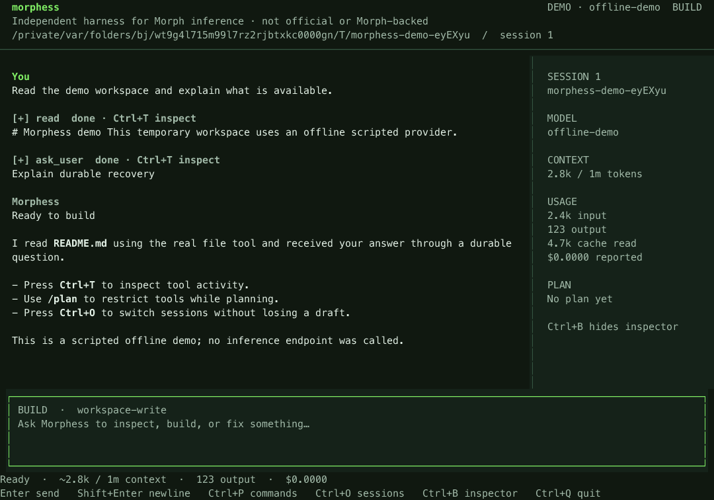

# Terminal workspace

Morphess is an independent, unofficial harness designed to work with Morph inference. It is not developed, endorsed, sponsored, or backed by Morph. The green ASCII emblem comes from Morph's official documentation logo, with provenance in [assets/brand](../assets/brand/README.md). Startup uses bundled data and makes no branding network requests. Restored sessions show the mark briefly; typing dismisses it immediately without losing input.

Run `node dist/cli.js` or `node dist/cli.js tui`. Use `--session <id>` to return to a specific conversation. `npm run tui:demo` opens a temporary, scripted offline workspace without credentials. Node 26.4+ is required for the native terminal; the launcher enables experimental FFI automatically. Headless commands do not load OpenTUI.

The default is a focused coding session. The optional inspector shows the selected session, approximate context, reported usage/cost, and plan. It appears at 110 columns or wider and remembers your preference. At 60 columns, the composer, status, and essential controls remain available.

## Keyboard

| Key | Action |
| --- | --- |
| Enter | Send, steer, or answer a pending question |
| Shift+Enter / Alt+Enter | Insert a newline (terminal support varies) |
| Ctrl+P | Search commands |
| Ctrl+O / Ctrl+N | Switch / create session |
| Ctrl+B | Toggle context/plan inspector |
| Ctrl+T | Inspect retained tool details |
| Ctrl+R | Read the full pending question and every suggested answer |
| Ctrl+Y | Request terminal clipboard copy of selection or last answer |
| Ctrl+U | Clear composer |
| Up / Down | Prompt history when composer is empty |
| PageUp / PageDown | Scroll transcript or detail view |
| Escape | Close a menu first; otherwise stop current work |
| Ctrl+C | Abort current work; quit if idle |
| Ctrl+Q | Quit and preserve recoverable work |

A multiline composer keeps per-session drafts. Accepted work uses Pi Durable; quitting the TUI preserves unfinished tasks for the next host. Explicit abort cancels the selected ownership subtree. Pending questions survive a clean close/reopen, and questions from active delegated agents appear in the selected parent's workspace. Enter a suggested number or any freeform answer. Answering a question does not grant shell or plugin authority.

## Commands

`/new`, `/sessions`, `/fork [entry]`, `/compact`, `/abort`, `/diff`, `/tools`, `/files [query]`, `/attach /path/to/image.png`, `/theme [forest|light|contrast]`, `/thinking`, `/answer text`, `/help`, `/quit`.

`/plan` restricts the selected conversation to an explicit read-only tool allowlist. Switch while idle; `/build` restores the exact prior enabled-tool selection, subject to the same extension and execution policy. Plan mode excludes shell, code mode, unknown plugin/MCP tools, and tool search that could enable mutating tools. Delegated children inherit the restricted tools; researcher/reviewer roles narrow them further. A read-only workspace policy still applies in build mode. Trusted shell requires `--trusted` or explicit trusted configuration.

File search inserts an `@path` reference; the model uses file tools to read it. This does not silently upload entire files. Image attachments are loaded through the bounded image validator when submitted. A failed submission keeps the draft for retry. `/thinking` reveals retained model reasoning only when the provider exposes it.

Forest, light and high-contrast themes preserve semantic roles. Clipboard copy uses OSC52 only in response to a user action and requires terminal support. The terminal owns its font, text size, and keyboard encoding.

## Bounded views and privacy

The view retains the most recent 80 display entries, 24,000 characters per message, and 64,000 characters per tool detail. It strips terminal control sequences; original source content remains available to the model and durable transcript. Full history is available through CLI export or the paginated API. Completed transcript nodes stay mounted during unrelated status/editor updates. Native watches coalesce updates at 40 ms; there is no idle polling animation.

Drafts, prompt history, theme and sidebar preferences live in private `<stateDir>/ui.json`, written atomically. Up to six recently edited drafts and 30 bounded history items persist within a 512 KiB file budget. Older history/drafts are dropped first when that budget is reached. Treat this file as sensitive alongside session databases. Recoverable task state and conversations remain exclusively in Pi's SQLite storage. No second agent loop or journal is introduced by the UI.

## Verification

On Node 26.4+, `npm run check` exercises the real native renderer at 120×36 and 60×20, keyboard controls, questions, draft/session transitions, theme colors, stable Markdown identity and cleanup. On older headless runtimes, native UI tests skip. `node --experimental-ffi --import tsx scripts/capture-tui.ts` recreates the documentation screenshots from the actual offline demo, including real tool execution and a durable answer.

